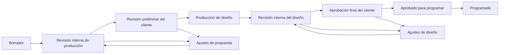

# Avans OS · evolución funcional de Ficha, Diseño y Contenidos

Fecha: 20/11/2026. Repositorio: `Avans-ai/avans-agency-os`. Rama exclusiva: `feat/avans-os-ajustes-reunion-2026-11-03`. PR existente: [#17](https://github.com/Avans-ai/avans-agency-os/pull/17), a conservar en draft.

**Estado: implementación y QA local completos; 175/175 pruebas aprobadas.** El estado remoto del commit final se registra en el PR #17 después del push. El código inspeccionado parte de `3c4a24ba61d6e9de2efd3d41c10fdd7ad4df6622`. No se declara validación del cliente ni de Dirección.

## Resultado funcional implementado

La cuenta conserva Discovery, cuestionario, fuentes, Benchmark, Plan, reportes, documentos y tareas existentes. La ampliación conecta la ficha de conocimiento con la producción: una idea se convierte en contenido, atraviesa revisiones internas y del cliente, genera un pedido de Diseño, conserva versiones y termina en una tarea de programación. Las tareas siguen siendo entidades únicas del workspace.

### Ficha del cliente

- Materiales organizados por categorías, con búsqueda, vista visual, descripción, estado, responsable, fecha y relaciones con productos y servicios. Admite archivo local, URL y texto; los archivos se conservan en IndexedDB y pueden recuperarse luego de recargar en el mismo navegador/origen.
- Productos y servicios amplían las ofertas canónicas de Discovery: categoría, beneficios, público, segmentos, ICP, materiales y servicios que los utilizan. Las referencias externas de plataforma/producto/variante preparan vínculos futuros sin anunciar una sincronización activa.
- Glosario central con palabras a usar/evitar, expresiones, tono, terminología, mensajes aprobados y fuentes. Los cambios conservan autor, fecha y versión; se rechazan términos contradictorios.
- Cuestionario inicial independiente, carga y revisión de información, impresión vacía/completada y aplicación de respuestas validadas conservados. La biblioteca nueva no duplica las fuentes anteriores ni cambia sus IDs.

Detalle de límites de archivos, relaciones y permisos: [CLIENT_PROFILE_EVOLUTION.md](CLIENT_PROFILE_EVOLUTION.md).

### Benchmark

- El Benchmark activo trabaja exclusivamente con competidores externos y referentes. La marca propia queda excluida de sus análisis, reportes y nuevas presentaciones.
- Los datos antiguos de marca propia permanecen almacenados para preservar el trabajo anterior; su existencia histórica no los convierte en input del Benchmark vigente.
- Se conservan análisis repetibles por marca, evidencia, fuentes, capturas, fechas y conclusiones. Se rechaza incorporar la marca del cliente bajo otra clasificación conocida.
- Las referencias interesantes se guardan en el Banco de ideas con URL, captura, motivo, eje y IDs del análisis de origen. Repetir la misma referencia no crea otra idea.
- No hay monitoreo externo automático ni extracción de rendimiento sin proveedor.

### Diseño de marca

- Design System visual con logos/variantes, paletas, muestras tipográficas, recursos, componentes, moodboards y aplicaciones, con edición y persistencia local.
- Biblioteca de piezas con cliente, origen, pedido/contenido relacionado, responsable, fecha, archivo, estado y versiones anteriores conservadas.
- Pedidos centralizados con brief, recursos, referencias, canal/formato, fechas y responsables. Los pedidos manuales guardan pedido y tarea juntos; los derivados de Contenidos reutilizan la tarea del contenido. Los pedidos heredados recuperan su tarea anterior mediante cliente, proyecto y servicio. El asistente opcional de Diseño anterior se conserva separado de la creación manual y no se presenta como conectado.
- La entrega de Diseño se vincula al contenido y conserva su versión en la biblioteca. Una devolución del cliente repite revisión interna antes de volver a solicitar aprobación final.
- Los materiales de identidad y el glosario se consultan desde la Ficha; la estrategia se consulta desde el Plan, evitando una copia independiente.

Cuando Contenidos requiere Diseño pero la cuenta no tiene contratado Diseño de marca como servicio separado, se habilita el espacio limitado de apoyo a esos pedidos: pedidos derivados, biblioteca, tareas e historial. Esto **no activa un contrato**, no incorpora el Design System como servicio contratado y no modifica los servicios guardados de la cuenta.

### Contenidos

- Plan mensual con mes, temáticas, cantidad objetivo, canales, formatos, fechas y responsables. Ejes reutilizables y Banco de ideas vinculado a Benchmark, carga manual, reuniones, documentos o URLs.
- Propuesta de contenido con título, eje, idea, bajada, objetivo, necesidades del cliente, copy preliminar, referencia, canal, formato y fecha. Idea y copy se presentan juntos para validación preliminar.
- Lista y Kanban de contenidos; calendario mensual, semanal con horarios y diario, con filtros por los canales solicitados. Las publicaciones sin horario se distinguen dentro de la agenda.
- Acciones por etapa y rol, validación de campos, comentario obligatorio al pedir ajustes/información y trazabilidad de cada transición.
- Edición y alta de borradores coordinadas con su tarea central; protección contra formularios obsoletos y guardado conjunto con rollback local ante fallas de almacenamiento.
- Programado representa un registro operativo local de la programación realizada. No envía una publicación a Metricool ni confirma que una red social la haya publicado.

Información del cliente es un estado de espera con devolución a la etapa de origen. «Aprobado» se conserva entre aprobación final y programación para distinguir la decisión del cliente de la ejecución del equipo. Los nombres anteriores se interpretan mediante compatibilidad de lectura; no se borran los registros guardados.

### Portal, tareas y notificaciones

- Ruta de portal por cliente: `/v2/portal/[client]`, con pendientes, contenidos, calendario, comentarios y adjuntos locales. La interfaz presenta solo el contenido compartido; excluye Kanban, responsables, historial y comentarios internos.
- La propuesta compartida tiene un snapshot de campos públicos para conservar lo presentado mientras el equipo aplica cambios internos. Las acciones del portal actualizan el mismo contenido y su tarea central.
- Roles visuales diferenciados: administrador, PM, Content, diseñador, líder técnico, cliente, proveedor externo y el perfil operativo anterior. Los perfiles externos no reciben la navegación de gestión interna.
- Una tarea por contenido se reasigna entre producción, revisión, cliente, Diseño y programación. Las devoluciones reutilizan la identidad y preservan comentarios e historial.
- Avisos por asignación, revisión, aprobación, devolución, bloqueo, cambio de responsable, respuesta del cliente y vencimiento. Los IDs incluyen cliente/tarea/evento para distinguir casos coincidentes; los enlaces abren el objeto que requiere la acción.
- Las acciones genéricas de una tarea vinculada no permiten saltear las aprobaciones del contenido: el usuario debe abrir la pieza y completar su revisión.

## Arquitectura y persistencia

Se mantienen las claves y sobres existentes de localStorage: prefijo `avans-os:preview:v1`, sobre `{ version: 1, value, savedAt }`. Las ampliaciones usan campos opcionales o colecciones de los módulos actuales. No se agregan tablas ni migraciones en esta entrega.

| Entidad requerida | Implementación canónica | Ubicación persistente / relación |
| --- | --- | --- |
| Materiales de marca / `client_brand_assets` | `KnowledgeState.sources` + `metadata.brandMaterial` | `client:<slug>:knowledge:v1`; referencias por IDs a productos/servicios |
| Original de un material/adjunto | Blob local | IndexedDB `avans-os-client-files-v1`, store `files`, clave `<clientSlug>:<fileId>` |
| Productos y servicios | `discovery.offerings` + `offering.profile` | Mismo agregado de conocimiento; segmentos en `targetSegments.offeringIds` |
| Glosario / `brand_glossary` | `KnowledgeState.brandGlossary` | Campo opcional del agregado existente, con fuentes/versiones |
| Benchmark | `KnowledgeState.benchmark` | Datos históricos preservados; selectores activos solo externos |
| Design System / `brand_design_tokens` | `ModuleRecord`, colección `sistema` | `client:<slug>:module:diseno-marca:sistema` |
| Pedidos / `design_requests` | `ModuleRecord`, colección `trabajos` | `client:<slug>:module:diseno-marca:trabajos`; `contenidoId` y `tareaId` |
| Entregables / `design_deliverables` | `ModuleRecord`, colección `biblioteca` | `client:<slug>:module:diseno-marca:biblioteca`; `piezaId`, `anteriorId`, versión y origen |
| Planes / `content_plans` | `ModuleRecord`, colección `planes` | `client:<slug>:module:contenidos:planes` |
| Ejes / `content_pillars` | `ModuleRecord`, colección `ejes` | `client:<slug>:module:contenidos:ejes` |
| Contenido / `content_items` | `ModuleRecord`, colección `piezas` | `client:<slug>:module:contenidos:piezas`; plan/eje/origen/tarea |
| Revisiones / `content_approvals` | Transiciones con actor, etapa, fecha, comentario, responsable y tarea | `values.contentTransitions` dentro del contenido |
| Conversación / `content_comments` | Comentarios estructurados con visibilidad y adjunto | `values.contentComments` dentro del contenido |
| Calendario / `content_calendar` | Proyección de fecha, hora, canal y estado | No se crea una segunda colección editable de publicaciones |
| Banco / `content_ideas` | `ModuleRecord`, colección `ideas` | `client:<slug>:module:contenidos:ideas`; IDs de origen de Benchmark |
| Lineamientos / `service_guidelines` | Consulta al Plan/Ficha + procedimientos propios versionados | `client:<slug>:service-guidelines:<serviceId>` |
| Tareas / `service_tasks` | `OsTask` existente | `workspace.tasks`; `clientSlug`, `workItem`, `workflow` |
| Notificaciones / `task_notifications` | `WorkflowNotification` | `workspace.notifications`; ID estable y estado de lectura |
| Avisos del portal leídos | Clave por cliente | `client:<slug>:portal:read` |
| Conexiones / `integration_connections` | Contratos y estados de disponibilidad; sin conexión nueva | No se persisten tokens ni se crea una conexión ficticia |

`writeLocalBatch` serializa primero, guarda las entidades del cambio y emite eventos al terminar; si falla, intenta restaurar los valores anteriores. El workspace compara valores para evitar escrituras de eco entre pestañas. Una transición o actualización recibida invalida cualquier «Deshacer» basado en un snapshot anterior de tareas, para impedir restaurar estados obsoletos. `useOsStore` conserva un snapshot inicial compatible con SSR hasta que cada consumidor se hidrata.

Esta coordinación local no es una transacción durable de servidor. Los binarios y metadatos viven en almacenes diferentes; la biblioteca/portal retira un adjunto nuevo si falla el guardado de su referencia. No hay sincronización entre usuarios, dispositivos u orígenes de Preview. Los archivos antiguos se conservan cuando los necesita el historial.

## Decisiones de interpretación

| Fuente o contradicción | Decisión aplicada |
| --- | --- |
| Código y pruebas anteriores incluían baseline de marca propia en Benchmark | Prevalece la exclusión explícita de Dirección indicada en el pedido. Se ajustan selectores, reportes y nuevas presentaciones sin eliminar el dato histórico. |
| `docs/VISUAL_IDENTITY.md` contiene recomendaciones iniciales de Inter/gradientes/lila | Prevalece la identidad aprobada del pedido y del sistema actual: Figtree, negro, blanco/crema y coral. No se realiza otro rebranding. |
| Brief inicial describe IA en múltiples pasos; reunión del 17/11 la posterga | Flujo manual completo primero. No se agrega generación obligatoria ni una IA simulada. Los avances anteriores de asistentes se conservan donde corresponde, sin presentarlos como proveedor conectado. |
| Notas mencionan «Cloud Design»; pedido explicita «Claude Design» | Se identifica Claude Design de Anthropic Labs; no se asume una API pública de edición. Arlis permanece sin proveedor identificado. |
| Captura Monday y lista de ocho etapas usan nombres distintos | Se conservan revisión de propuesta, revisión de diseño, información del cliente, ajustes, aprobado y programado con nombres claros. Las devoluciones repiten la revisión necesaria. |
| Contenidos necesita diseñador, pero Diseño de marca puede no estar contratado | Apoyo operativo limitado a los pedidos derivados; no se activa el contrato ni se duplica una tarea. |
| El portal está solicitado, pero backend sigue pausado | Se implementa la participación local y una proyección pública explícita. Autenticación, permisos de servidor y sincronización quedan pendientes y se informan en pantalla. |

## Integraciones y credenciales

La investigación con fuentes oficiales está en [INTEGRATIONS_EVOLUTION_2026-11.md](INTEGRATIONS_EVOLUTION_2026-11.md).

- **Metricool:** lectura del calendario y escritura documentadas por el proveedor; cuenta de prueba, plan con API, token, marcas y permisos de Avans pendientes. Damián debe obtener acceso de Gabi; esta tarea no envió mensajes a terceros. Sin llamadas autenticadas ni programación real.
- **Google Drive/Workspace:** adapters y contratos existentes conservados, rutas cerradas hasta disponer de identidad real, repositorios, consentimiento y pruebas. Registrar un archivo o URL local no conecta Drive.
- **Claude Design:** referencia conceptual, URL compartida e intercambio manual de recursos; API de edición no verificada.
- **Arlis:** falta URL o identificación comercial exacta. No se sustituye por Artlist u otra plataforma.
- **Tiendanube:** OAuth, catálogo y estrategia de IDs investigados. La ficha prepara referencias externas; falta instalación autorizada, prueba de tienda y sincronización real.
- **IA:** automatización nueva de Contenidos pospuesta; creación manual sin llamadas al asistente. Asistentes anteriores conservados en los módulos correspondientes y estados de proveedor honestos. Sin modelos simulados presentados como activos.

No se ejecutaron migraciones Supabase, no se activó su backend y no se modificaron dominios ni variables de producción por esta ampliación. La habilitación futura debe incluir Auth, autorización por organización/cliente, RLS, almacenamiento remoto, cifrado de credenciales, conciliación e idempotencia con pruebas reales.

## QA y trazabilidad

Los **33 pasos solicitados** están mapeados individualmente en [EVOLUTION_QA_CHECKLIST.md](EVOLUTION_QA_CHECKLIST.md). La suite completa se ejecutó contra el build local de esta entrega: 104 pruebas de dominio y 71 de navegador, sin fallos.

| Bloque del pedido | Suites principales | Alcance |
| --- | --- | --- |
| 1–6 Ficha, cuestionario, archivos, producto, catálogo y glosario | `profile-library-*`, `strategic-documents-browser`, `intake-presentation-*`, `discovery-*` | CRUD, relaciones, originales, revisión/impresión, recarga, fuentes y permisos visuales |
| 7–9 Benchmark e ideas | `benchmark-evolution-*`, `knowledge-*`, `pptx-generation-model` | Exclusión propia, competidor, evidencia, captura, origen y deduplicación |
| 10–13 Diseño y tarea | `design-workspace-*`, `modules-browser` | Design System visual, versiones, pedido/tarea, rollback, apoyo sin activar contrato |
| 14–17 Planificación y revisión interna | `content-workflow-*` | Plan, ejes, ideas, contenido, validación mínima y calendario |
| 18–25 Cliente, ajustes, Diseño, final y programación | `content-workflow-*`, `portal-*`, `workflow-integration-*` | Ambas devoluciones, actor/rol, tarea única, portal y programación local |
| 26–28 Calendario, avisos e historial | `content-workflow-*`, `portal-*`, `workflow-integration-*` | Mes/semana/día, canales, enlace directo, lectura, cronología y versiones |
| 29–32 Clientes, roles y mobile | Suites nuevas + `operations-clients-browser`, `discovery-browser`, `modules-browser` | IDs coincidentes en clientes distintos, lectura/edición, 390 px y recarga |
| 33 Regresión de áreas previas | `operations-clients-browser`, `modules-browser`, `strategic-documents-browser`, `assistant-*`, `intake-presentation-*`, `pptx-*` | Inicio, Clientes, Tareas, Discovery, Plan, Reportes, módulos y presentaciones |

La regresión final ejecutó **175 pruebas aprobadas** en 3 minutos, con dos workers y Chromium `/usr/bin/chromium`. Incluye 9 pruebas de dominio y 4 de navegador de coordinación de tareas, rollback ante cuota, aislamiento, enlaces de avisos, roles y dos pestañas. También cubre archivos originales recuperables, datos heredados, snapshots públicos, formularios obsoletos y la invalidación de un «Deshacer» anterior a una transición. No quedaron pruebas fallidas o ignoradas.

### Verificación final del commit de entrega

| Verificación | Estado final |
| --- | --- |
| `npm ci` | Aprobado, 379 paquetes. Se usó `--cache /tmp/avans-npm-cache` porque el caché predeterminado del entorno no era escribible. |
| Auditoría de dependencias de producción | Aprobada: 0 vulnerabilidades (`npm audit --omit=dev --audit-level=high`). |
| `npm run lint` | Aprobado: 0 errores, 4 advertencias heredadas. |
| `npm run typecheck` | Aprobado. |
| `npm run build` | Aprobado, Next.js 16.4.5; 289 páginas generadas. |
| Suite completa de dominio | **104/104 aprobadas**. |
| Suite completa de navegador contra build | **71/71 aprobadas**, Chromium; total integrado **175/175**. |
| Revisión visual responsive final | Verificada localmente: portal, Diseño, Ficha y Contenidos; 1440/820/390 px según suite. Capturas desktop/mobile inspeccionadas. |
| Diff, secretos y preservación de rama/main | Diff revisado y `git diff --check` sin errores. Sin coincidencias en búsqueda de patrones de credenciales; `main` conserva `8974172`. Sin cambios en migraciones, variables ni configuración Vercel. |
| Validación de Avans/cliente | **No realizada** |

## Publicación en Preview

| Dato | Estado |
| --- | --- |
| Rama | `feat/avans-os-ajustes-reunion-2026-11-03` |
| Commit de implementación | `74015f4055422ffad19ea70f98abf5feaccee956`; seis commits de funcionalidad por dominio. La documentación final tiene un commit adicional, identificado por el head del PR. |
| Push de la rama | El resultado del push del commit final se consigna en el PR #17 y en el informe del chat. |
| PR #17 | Abierto y **draft** antes del push; se conserva ese estado. La confirmación posterior se registra en el PR y el chat. |
| Quality Gate de GitHub | Consultar en el PR #17 la ejecución correspondiente al SHA final; no se infiere del build local. |
| Deployment Vercel del commit final | Consultar en el PR #17 el check Vercel del SHA final y su enlace de deployment. |
| URL de rama esperada | [Avans OS Preview](https://avans-agency-os-git-feat-avans-os-ajustes-reunion-827e1a-avans2.vercel.app/v2) |
| Prueba funcional remota | Bloqueada desde este entorno: proxy HTTP rechaza el túnel con CONNECT 403. El conector Vercel tampoco tiene acceso al equipo `avans2`; la evidencia de deployment se obtiene mediante el check de GitHub asociado al SHA. No inferir QA remoto del estado Ready. |

No crear otra rama ni PR, no hacer merge y no publicar en producción. «Implementado», «probado localmente», «desplegado en Preview» y «validado por el cliente» son estados distintos.

## Segunda etapa y pendientes reales

Publicidad Digital, Audiovisuales, Desarrollo Web, CRM y automatizaciones anteriores se conservan. Comparten la arquitectura de Lineamientos/Operación mensual; quedan pendientes sus profundizaciones específicas: conexión real de campañas y métricas, proveedores/jornadas audiovisuales, desarrollo y publicación web, CRM y automatizaciones avanzadas. No se presenta su existencia previa como una implementación nueva de esos procesos.

Para la siguiente etapa: habilitar persistencia y permisos backend con aprobación correspondiente; validar conectores con cuentas reales; identificar Arlis; acordar alcances de escritura externa y sincronización; evaluar IA solo después de validar el flujo operativo. Ninguna de estas dependencias impide utilizar y revisar los recorridos locales implementados, pero sí impide considerarlos operación multiusuario productiva.
